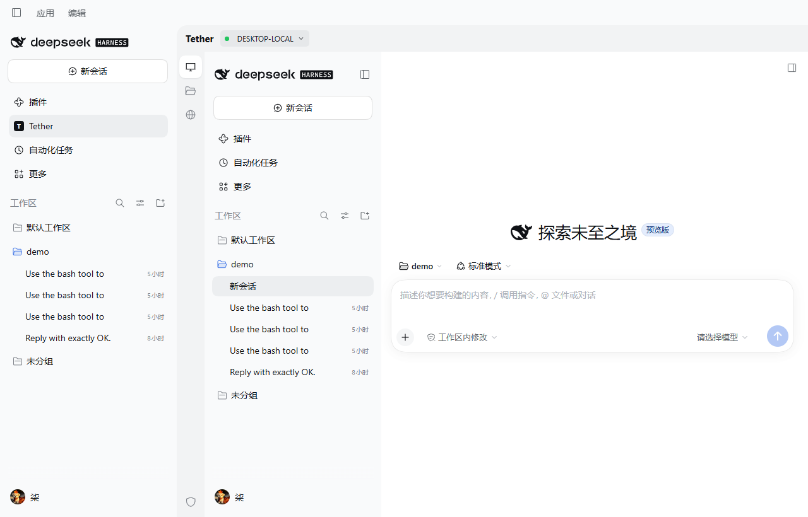
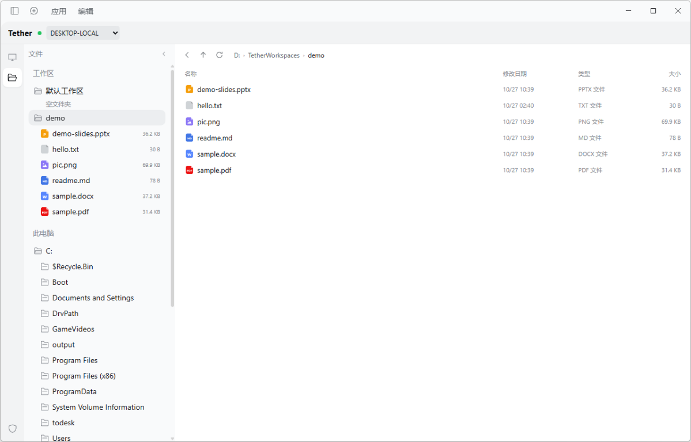
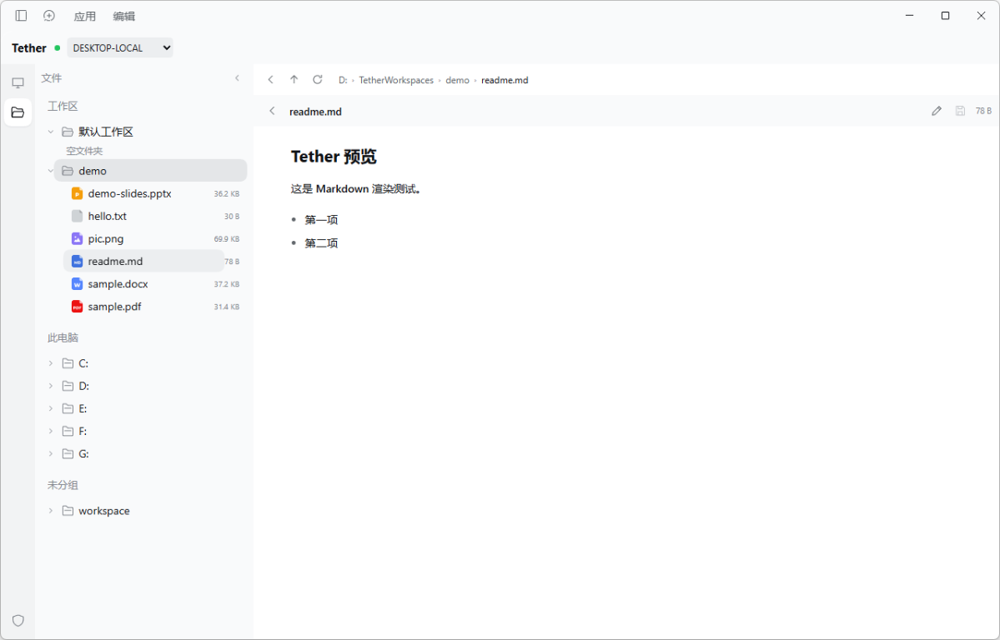
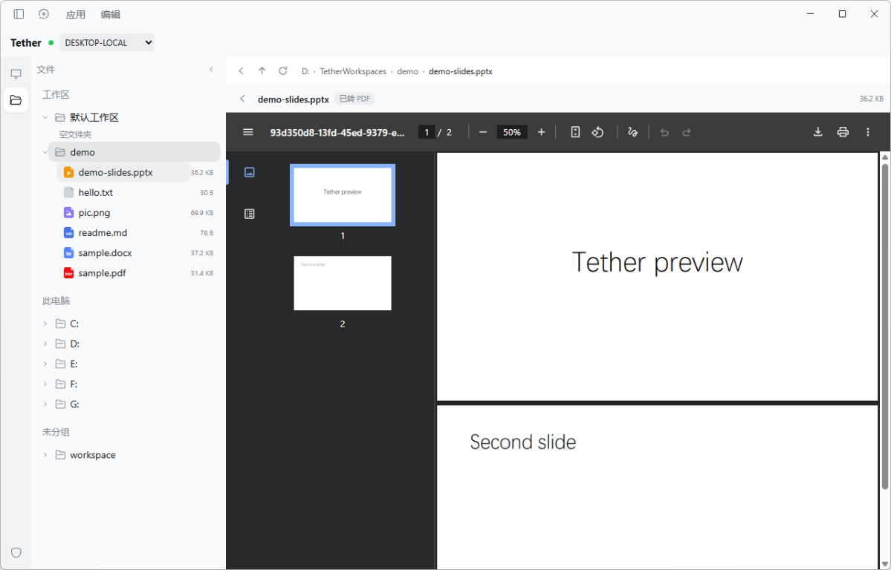
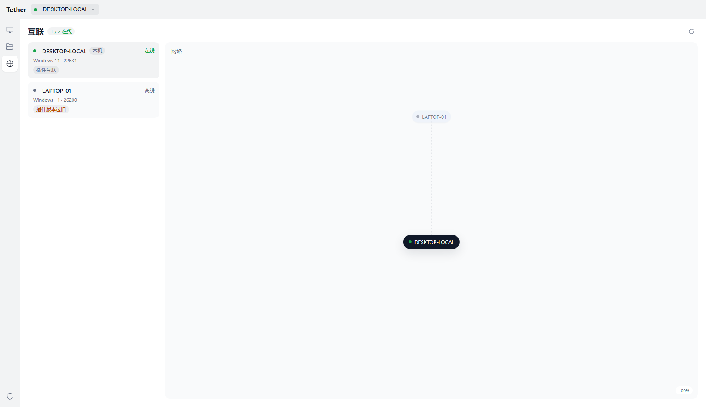
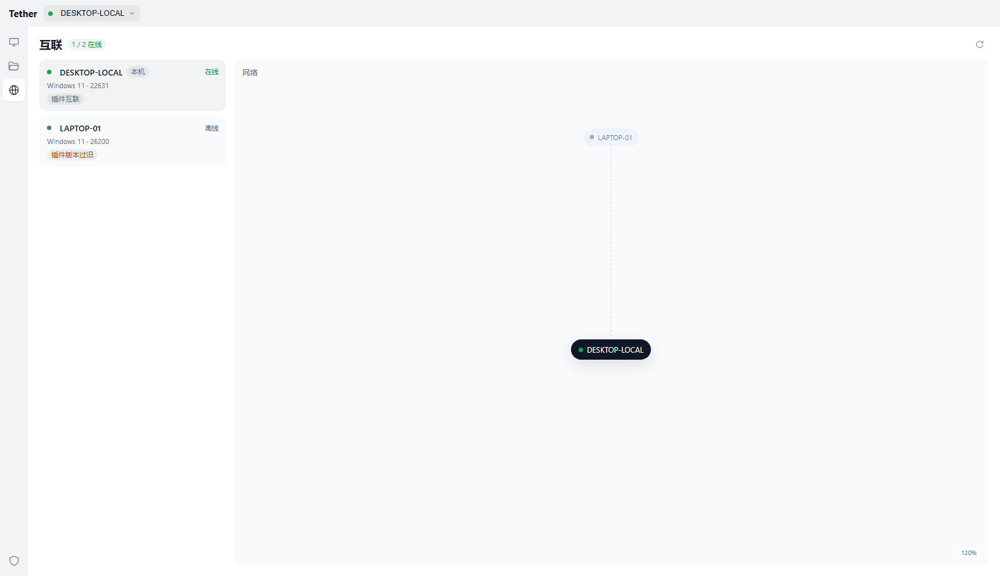
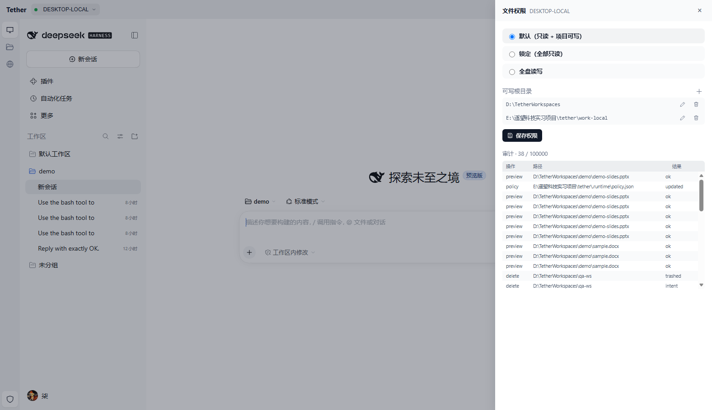
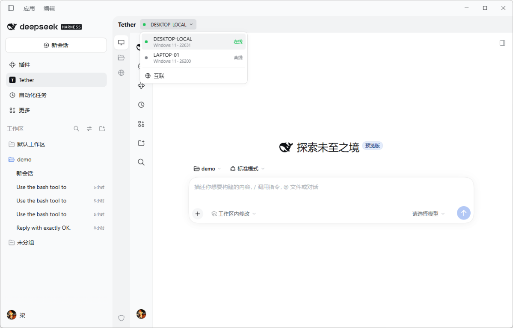

# Tether

> DeepSeek Harness stays the Agent. Tether is the plugin and MCP tool that let it work on other machines.

A multi-device Agent Harness client. You work inside the **DeepSeek Harness desktop
app**: the Tether plugin loads the target machine's **own running DSH web surface**
(workspaces, sessions, model and permission menus, `@` file references, attachments
and trajectory) through a per-device loopback gateway, and adds a Tether
file/permission side panel. The same control plane exposes seven MCP tools, so the
DeepSeek Agent can delegate a task to another computer. The target machine runs its
own Harness Agent with its own files, shell, and model key.

Repo: https://github.com/qi001007/tether-harness

[Preview](#preview) · [Current release](#current-release) · [Quick start](#quick-start-dsh-plugin--mcp) ·
[The plugin page](#the-dsh-plugin-page) · [File policy](#file-policy) ·
[Deploy a second machine](#deploy-on-a-second-machine) · [APP plan](docs/APP_PLAN.md)

```
DeepSeek Harness desktop (Agent + Tether plugin + MCP tools)
   │ Tether page                          │ MCP stdio
   ▼                                      ▼
per-device loopback gateway ──HTTP/WS──► Tether Controller (FastAPI + SQLite)
                                             ▲
                                             │ outbound WSS + token (Tailscale / LAN)
                                   ┌─────────┴─────────┐
                                   ▼                   ▼
                         Node DESKTOP-LOCAL     Node LAPTOP-01
                         ├─ OS file/policy      ├─ OS file/policy
                         └─ loopback ─► DSH Host└─ loopback ─► DSH Host
```

The Tether plugin is the **remote DSH page**: the target Host supplies the native
workspace/session navigation, composer, model menu, permission menu and writer;
Tether supplies the device switch and the file/permission tools around it. Tether
does not replace DSH memory, skills, or marketplace.

## Preview

These are screenshots from the current Electron/DSH build, not mockups. The target
Host page is the real DSH desktop UI; the file, network and permission panels are
Tether-owned.

| Native DSH workspace | File explorer |
|---|---|
|  |  |
| **原生工作区**: the target machine's own DSH Host, embedded through the per-device gateway. | **文件资源管理器**: workspace/drive tree, details list, breadcrumb, refresh and right-click actions. |
| **Markdown preview** | **Office preview** |
|  |  |
| Markdown is rendered in place; text can switch to edit mode and save. | DOCX/PPTX are converted to PDF by WPS/Office COM on the target, then shown in place. |
| **Network overview** | **Network at 120% zoom** |
|  |  |
| Node cards plus a local-centered topology; neutral 1px lines, dashed when an end is offline. | Lines keep a constant 1px screen width instead of growing with zoom. |
| **Permissions and audit** | **Device menu** |
|  |  |
| Compact responsive drawer: no per-option paragraphs, audit table fits narrow windows. | The same custom DSH-token device menu on the top bar, including OS and online state. |

More screenshots are in [docs/screenshots](docs/screenshots); older images are
kept as evidence and may show earlier UI.

## Current release

**Included in this repository now**

- DSH native client plugin: native DSH page, file explorer, previews, permissions/audit,
  network graph, device rename and context menus.
- Shared React UI package `packages/tether-ui`: the plugin bundle is generated from it,
  and a browser WebUI runs the same source through the `WebHost` adapter.
- Controller + Node + MCP tools, with Tailscale or LAN as the current transport.
- Self-hosted **Hub** mode: run the Controller on a public VPS with an access token,
  connect target Nodes outbound over WSS, and point the APP at the Hub
  ([deploy/hub](deploy/hub/README.md)).
- Regression tests and acceptance screenshots.

**Planned, not in this release**

- APP tray, full service page and packaging.
- Tether Relay/Account to replace the Tailscale dependency.

The Electron shell exists in `apps/tether-app` and reuses the same WebUI bundle. It now
supervises the local control plane: if `127.0.0.1:18890` already answers it attaches as
an external controller, otherwise it starts Controller + the local Node with the repo
`.venv`, waits for health, and kills the process tree on quit. The top-right `服务`
chip opens status/start/stop/restart and the log directory. Cross-machine control still
needs a reachable network path (LAN/port forwarding/Tailscale) until the Relay exists.
The plan is in [docs/APP_PLAN.md](docs/APP_PLAN.md). `desktop/tether-app.ps1` today is
only a launcher for the Controller/Node monitor window; it is not the standalone APP.

### Shared UI (Phase 1)

```
packages/tether-ui/src/app.js        createTetherPanel({ React, Native, host })
packages/tether-ui/src/hosts/dsh.js  DSH API base + native bridge
packages/tether-ui/src/hosts/web.js  Web fallbacks for FileEntryRow/FileTypeIcon/Markdown
```

`packages/dsh-plugin-tether-client/lib/client.js` is generated:

```powershell
node packages/tether-ui/scripts/build.mjs          # regenerate plugin bundle
node packages/tether-ui/scripts/build.mjs --check  # fail if out of date
npm --prefix packages/tether-ui run build:web      # browser bundle
node packages/tether-ui/web/serve.mjs              # http://127.0.0.1:18891
```

`web/serve.mjs` proxies `/api` to the Controller so the WebUI stays same-origin
(the Controller still only allows the `dsh-app://app` origin directly). The WebUI is a
development/acceptance entry for Phase 1; the Electron APP is Phase 2.

```powershell
cd apps/tether-app
npm install
$env:ELECTRON_RUN_AS_NODE = $null   # only if your shell sets it
npm start
```

The APP window loads the same `tether-ui` bundle through an embedded loopback server.
Its supervisor gives a target machine a local backend without any manual terminal:

- `127.0.0.1:18890` healthy → APP attaches as **external**, never starts a second copy;
- otherwise APP starts Controller + the local Node with `.venv\Scripts\python.exe`,
  waits up to 60 s for `/api/state`, and writes logs to `apps/tether-app/data/logs`;
- the top-right `服务` chip shows Controller/Node state and offers start/stop/restart
  plus the log and data directories;
- quitting the APP kills only the children it started, so the port is released.

This is what makes a freshly deployed machine work with the DSH plugin alone: the plugin
still points at `127.0.0.1:18890`, but that address now has a real Controller and Node
behind it. It does **not** create a network between two machines; for that the control
plane still needs a reachable path (see below).

### Across two networks (self-hosted Hub)

If you have a VPS with a public IP and an optional domain, run the existing Controller
there as a Hub instead of adding a new tunnel protocol:

- VPS: Controller bound to `127.0.0.1`, behind Caddy TLS, with
  `TETHER_ACCESS_TOKEN` (operator) and `TETHER_NODE_TOKEN` (nodes).
- Target machine: `TETHER_CONTROLLER=wss://<hub>/ws/node`; Node only opens outbound WSS.
- Operator APP `.env`: `TETHER_CONTROLLER_URL=https://<hub>` +
  `TETHER_ACCESS_TOKEN=...`; the embedded proxy injects the token server-side.

Step-by-step commands, a systemd unit, the self-signed fallback, and current limits are
in [deploy/hub/README.md](deploy/hub/README.md). File explorer, permissions, rename and
audit work through the Hub; the native DSH iframe is not yet proxied through the public
origin (local plugin still shows it on the target).

## What is verified

| Claim | Evidence |
|---|---|
| DeepSeek Harness desktop Agent calls Tether itself | In the official desktop app, the Agent called `list_peers` and returned the paired devices with online flags |
| Agent-to-Agent delegation | The desktop Agent called `remote_task` for `LAPTOP-01`; the laptop created `D:\tether-node\work\tether-delegated.txt` with `OK` |
| Same harness session on the target | A second read-only verification run reused `dsh_session=tether-s-d0332f33ad47` |
| Real dsh writes/reads files | `tether-delegated.txt` is 2 bytes, bytes `4F 4B`, no BOM/newline |
| Cancel leaves no residual tree | before: dsh → sandbox → pwsh → python (6 procs); after: only the node daemon (0 residual) |
| Network drop does not lose events | 8s socket drop; events buffered in the node outbox; 13 events, contiguous `seq`, no duplicates |
| Idempotent submission | same `request_id` + content returns the first run; different content returns 409 |
| Node crash is not a false failure | run becomes `unknown`; never auto-reruns; `reconcile` reports the node ledger |
| Cross-machine over Tailscale | `LAPTOP-01` registered and executed over `100.x`; controller UI/API stays loopback-only |
| DSH plugin installs and renders | Clean remove/reinstall via `desktop/install-plugin.ps1`; sidebar `Tether`; device/project/file/task page renders |
| Target native DSH page over a gateway | `DESKTOP-LOCAL` opens the target Host's model list, permission menu, `@hello.txt` reference and trajectory; ticket/cookie/origin checks in `tests/test_native_surface_gateway.py` |
| Custom device menu | DSH-token typography, online dots, device name + OS version (Windows 11 detected by build), 互联 footer; outside click (including the native iframe) and Escape close it |
| Existing session stays on the target writer | The native page edits the selected session in place; no second SDK process is opened for it |
| Existing DSH workspace is writable in readonly mode | `default-workspace` write resolves to `D:\DeepSeek harness\workspace`; audit records `intent` + `result` |
| Readonly really blocks outside writes | `C:\Users\...\Documents\tether-full-test.txt` → HTTP 400 `path outside allowed roots` |
| Full-disk mode is explicit and still guards the OS | `mode=full` allowed the same write; `C:\Windows\...` stayed denied; `.dsh/.credentials.yaml` unreadable |
| Delete is recoverable | delete moved the file to `D:\TetherWorkspaces\.tether-trash\<timestamp>-<name>` |
| Legacy transcript reader | `session.v4.jsonl.zstd` parsed into 2 turns / 8 blocks; kept for history/evidence, no longer a plugin page |
| Tether task becomes a native DSH session | run `r-00aac51ff0ac` → `tether-s-91e5ba584d36` in target `~/.dsh/sessions`; attached to the demo workspace registry |
| Workspace roots in the file tree | `/workspaces` supplies `default-workspace`/`demo`; grouped under `工作区`; `未分组` lists loose session cwds |
| File Explorer | left tree `工作区` / `此电脑` / `未分组`; right details list, breadcrumb, back/up, spinning refresh; click a folder to sync both sides |
| File previews | Markdown rendered; text edit/preview; image and PDF rendered in place; DOCX/PPTX converted to PDF through WPS COM (`preview` audit rows) |
| Context menu + permissions | right-click 打开/重命名/删除/新建文件/新建文件夹/刷新; shield-only settings; writable roots rows; SQLite audit with 100,000-row cap and 200-row pages |
| 互联 page | all nodes as cards (online/OS version/capability) plus a local-centered topology with online/offline links; `network-final.png` |
| Plugin live task + cancel | run `r-f358e95993e9`: first event in 1261 ms; cancel → `cancelled` |
| New project location | `demo` created under `D:\TetherWorkspaces\demo`; node workspace and DSH workspace unchanged |

Not yet verified: the laptop's native page (`LAPTOP-01` still runs the previous
node build), a real model send from an existing session, and attachment upload.
The native page has been verified on `DESKTOP-LOCAL` only.

The main views are embedded in [Preview](#preview). More screenshots and older
evidence are in [docs/screenshots](docs/screenshots). Raw notes:
[`evidence/gate0.md`](evidence/gate0.md),
[`evidence/gate2.md`](evidence/gate2.md),
[`evidence/dsh_plugin_fs.md`](evidence/dsh_plugin_fs.md),
[`evidence/cancel_probe.json`](evidence/cancel_probe.json).

## Quick start (DSH plugin + MCP)

Prerequisites: Windows, Python 3.11+, Node 24 + npm, the official DeepSeek Harness
desktop app (https://www.deepseek.com/harness/).

For the native page, every target must run DSH desktop and have the Tether bundle
installed; a Node alone is not enough. After updating a target, close DSH
normally, run `desktop/install-plugin.ps1`, start DSH, then restart its Node. The
`tether-dsh-surface` companion publishes the target Host descriptor at startup.

```powershell
# 1) Tether control plane + local node (the Tether window is only a monitor)
python -m venv .venv
.\.venv\Scripts\python.exe -m pip install -e .
npm install --prefix .runtime\npm --no-audit --no-fund "@deepseek-ai/dsh@0.2.1-rc.2"
Copy-Item .env.example .env   # fill DEEPSEEK_API_KEY
.\desktop\tether-app.ps1

# 2) Install the Tether client plugin into the DSH desktop profile
#    (close the DeepSeek app first; it rewrites profile files on exit)
.\desktop\install-plugin.ps1
# then start DeepSeek Harness and click "Tether" in the sidebar

# 3) Optional: add Tether MCP so the DSH Agent can delegate tasks
.\desktop\install-mcp.ps1
# restart DeepSeek Harness, then ask its Agent:
#    用 Tether 列出当前已接入的设备
#    让 LAPTOP-01 的 Agent 在 D:/tether-node/work 建一个文件并读回来
```

`install-plugin.ps1` only appends `tether-dsh-plugin` to
`~/.dsh/profiles/desktop/package.json` and installs its two packages. It does not
touch the other bundles or `cordis.patch.yml`; removing the package restores the
original DSH boot.

The desktop app keeps its own memory/plugins. Tether MCP adds these tools:

- `list_peers`
- `remote_task(device, prompt)`
- `remote_status(run_id)`
- `remote_cancel(run_id)`
- `remote_workspaces(device)`
- `remote_files(device, path, op, text?, dest?)` — list/read/write/mkdir/rename/delete
  under the target node's policy
- `remote_audit(device, limit)`

## Deploy on a second machine

Use the same repository revision on both machines; do not mix an old Node with a
new plugin.

1. Clone/pull `main` and create `.env` from `.env.example`. Set `TETHER_DEVICE`,
   `TETHER_CONTROLLER` and the paths for that machine; keep API keys in the local
   (gitignored) `.env`.
2. Close the target DeepSeek Harness normally, run `desktop/install-plugin.ps1`,
   then start DSH again and confirm that **Tether** appears in the sidebar.
3. For a controlled machine, start/update its Node (`laptop/tether-node.ps1` or
   `python -m tether.node.agent ...`) with the same revision. The native DSH page
   needs DSH Desktop running on that machine, not just the Node.
4. Cross-machine reachability currently needs a reachable Controller (Tailscale
   or LAN/port forwarding). The self-hosted Relay/APP is planned, not in this
   release.

## The DSH plugin page

The primary view is the **target machine's own DSH page**, not a re-built chat
window. When the target runs DSH desktop with the Tether surface companion, the
target Host serves its HTML, model menu, permission menu, `@` file references,
attachments, trajectory and session writer. Tether frames that Host through a
per-device loopback gateway. The plugin's own chrome is one slim top bar with a
custom device menu plus a 44px activity bar: 原生工作区, 文件资源管理器, 互联, 文件权限.
There is no Tether-written conversation page.

```
target DSH desktop (own Host + session writer)
        │ loopback HTTP + /api/remote.mux WebSocket
        ▼
target Tether Node ── outbound WSS ──► Controller ── per-device gateway ──► plugin iframe
```

The target DSH loads `tether-dsh-surface`, which only publishes a private
descriptor (`$DSH_HOME/storages/tether/native-surface.json`) with the current
loopback origin and an authenticated URL. The target Node validates and uses that
origin; the credential never enters the browser, Controller database or logs.
Each device gets its own gateway with a single-use ticket, an HttpOnly
`Partitioned` cookie and an origin allowlist (`dsh-app://app`). HTTP/WS bodies are
capped at 8 MiB; the browser never supplies an upstream URL.

Because this is the target's real Host page, **existing sessions continue in
place** with the target's own writer. The old Tether transcript reader remains
backend/evidence only; it is not a plugin page. The target must be running DSH
desktop; installing the Node alone is not enough for this view.

The activity bar is the only Tether-owned navigation:

- **原生工作区**: the monitor icon returns to the target Host page. Workspaces,
  sessions, model/permission menus, `@` file references, attachments, trajectory
  and the writer are the target DSH's own.
- **文件资源管理器**: a real Explorer view. The left tree has `工作区`
  (`default-workspace`, `demo`, ...), `此电脑` (`C:`–`G:`) and `未分组` when a
  loose session has its own cwd. Clicking a folder row toggles it and syncs the
  right pane in one target; there is no separate chevron to hunt. The right pane
  shows the current directory as a details list (name / modified / type / size);
  double-click enters or previews. File/folder icons come from DSH's
  `FileTypeIcon`, so Word/PDF/PPT/image/Markdown are distinguishable on both
  sides. The breadcrumb, back/up icons and refresh icon keep both sides in sync;
  the refresh icon spins while loading. There are no text toolbar buttons for
  new/rename/delete.
- **Right-click**: background and rows open an app-style context menu with
  `打开`, `重命名`, `删除`, `新建文件`, `新建文件夹`, `刷新`. New/rename use a
  small modal; delete goes through a confirmation and `.tether-trash`.
- **Preview**: Markdown is rendered (with an edit toggle), text is shown in a
  preview/edit pane, images/PDF render in place, and DOC/DOCX/PPT/PPTX are
  converted to PDF on the target through the installed WPS/Office COM bridge
  before display. Unsupported binaries show a clear message instead of a blank
  page. Conversion requires WPS/Office on the target; PDF/Markdown/image preview
  does not.
- **互联**: a whole-network page. The left side lists paired nodes with online
  state, platform, workspace and capability badges, 8 per page with a pager;
  the right canvas fills the remaining space and draws the local node in the
  center. Lines are neutral gray (no status color), touch the node edge, and the node
  covers the last pixel; solid means connected, dashed means the control relationship
  exists but either end is offline, and an absent line means no control edge (explicit
  edges are a v0.2 design). At normal zoom non-local nodes
  sit on a light chip with a soft shadow so the frame is visible. Right-click a card
  or graph node to rename it; the display alias is stored by the Controller, survives
  reconnects, and is pulled by every Tether client connected to that Controller. Drag the divider
  to resize the list, double-click it to reset; use the wheel to zoom (40%–120%). Below 72% labels
  disappear and nodes become 22/16px opaque flat circles: the local node stays black
  to match its expanded chip, child nodes use a blue-tinted `color-mix` surface, and
  `corner-shape: round` keeps them true circles against DSH's global superellipse.
  No border, glow, glass, gradient
  or sheen; selection only deepens the fill. Drag any node: it moves with viscous momentum,
  and the links behave like slow elastic bands instead of returning to a fixed
  anchor. Click a card to select the device; double-click to open its native page.
  This is the place for the future network/topology view.
- **Permissions**: the shield at the bottom of the activity bar is the only
  entry. Clicking outside the drawer (or Escape) closes it. It offers readonly /
  locked / full-disk, an editable writable-root list (add via `+`, edit/delete
  per row), and paginated SQLite audit rows with a 100,000-row cap; memory stays
  constant. The audit covers Tether file-service writes/deletes/policy/Office
  conversion and denied reads on the target, not the DSH Agent's own commands;
  writes show `intent` and `result` rows. This is separate from the target DSH's
  own session permission menu.

The activity bar uses DSH's own 16px/1px artwork (`workspace-tree`,
`folder-open`, `globe`, `plus`, `chevron`), not a parallel icon style. The file
panel width is draggable, double-click resets, and the width is stored in
`localStorage`. Section labels (`工作区`, `此电脑`, `未分组`, `文件`) use the DSH
sidebar's 13px/400/tertiary header tokens, not a separate bold style.

The surface follows six visual rules: hierarchy comes from background layers
(base / sidebar / hover / active), not 1px frames; dark mode uses thinner text
weights; assistant replies/tool cards fade in with an ink-like blur; times,
steps and token counts use tabular numerals; drag handles respond on hover and
reset with a short spring; buttons/rows compress on press. Colors come from DSH
theme tokens, so light and dark follow the app.

The old Tether transcript reader remains in the node for history/evidence and
old-node compatibility, but it is no longer a plugin page. New Tether tasks run
through the target's SDK in the target DSH home and workspace, so they are native
sessions and are attached to the workspace registry. Existing native sessions are
continued only through the native surface (the target Host writer). The reader
defaults to `~/.dsh`; set `TETHER_NATIVE_DSH_HOME` if needed. It requires
`zstandard`, installed by `pip install -e .`.

### File policy

- **readonly (default)**: all disks readable; writes allowed only under
  `D:\TetherWorkspaces`, the node workspace, and existing DSH workspaces.
- **locked**: everything readable, every write/mkdir/rename/delete denied; used to
  hand over a read-only live machine temporarily.
- **full**: explicit opt-in in the permissions drawer, with a confirmation dialog.
  Writes are still refused under Windows/Program Files/ProgramData, `.ssh`,
  `.dsh`, `.aws`, `.config`, and `AppData`; `.dsh/.credentials.yaml` is unreadable.
- **delete** moves to `D:\TetherWorkspaces\.tether-trash\<time>-<name>` instead of
  erasing.
- Every write/delete/policy change is audited on the node before and after the
  operation (`phase=intent` / `result`).

## Quick start (laptop node)

```powershell
# clone/copy this repo to the laptop, then:
.\laptop\bootstrap-node.ps1
# edit .env: DEEPSEEK_API_KEY, TETHER_CONTROLLER=<desktop Tailscale IP>
.\laptop\tether-node.ps1
```

The laptop needs Tailscale (same account as the desktop) or a reachable controller
address. Only outbound WSS is used; the laptop opens no inbound port. Its local
console is `http://127.0.0.1:18893`.

Existing nodes must be updated to the current `tether/node/` code (copy the repo
over `C:\tether-node\app` and restart `tether-node.ps1`) to get the filesystem
service, policy and audit. New projects default to `D:\TetherWorkspaces`; override
with `TETHER_WORKSPACES_ROOT` before starting the node.

## Important: dsh runtime on Windows

`deepseek-harness-sdk==0.2.1rc2` ships a Windows runtime that resolves
`@koromix/koffi-win32-x64` to the build-machine path `E:\snapshot\node\...`.
Every turn fails with `The specified module could not be found`.

Workaround used by the Tether node: install the npm runtime and point the Python
SDK at it (`tether/node/dsh_adapter.py:npm_launch_args()`). The SDK still owns the
session, events, resume, and shutdown; only the runtime binary comes from npm.

The desktop app has its own bundled runtime and is not affected.

## Design boundaries

- **Agent-first**: the interaction surface is DeepSeek Harness (or another MCP
  Agent such as Qoder/Codex). Tether does not replace its memory/plugins.
- **Thin client**: the plugin page talks to the controller over loopback HTTP with
  CORS allowlisted to the `dsh-app://app` origin; the planned `@Remote` host service is not implemented yet. The controller
  strips `/api` from the tailnet and keeps the node token server-side.
- **v0.1 topology**: one controller, multiple nodes; the desktop is the initiator,
  the laptop is a controlled node. The target peer-to-peer Agent network is in
  `DESIGN.md` §9 and is **not implemented**.
- **Tailscale is deployment-only**: the protocol needs a reachable Controller, not
  Tailscale. LAN/direct or port forwarding works; NAT-to-NAT needs our own
  relay/account service and optional WebRTC/QUIC. A plugin alone cannot make a
  public connection appear behind two NATs; see `DESIGN.md` §12.
- **Verified**: real dsh execution, MCP delegation, session continuation, event
  replay, idempotency, `unknown`, hard cancel with 0 residual, Tailscale, DSH
  plugin install/render, file policy/audit, recoverable delete.
- **Designed / not implemented**: symmetric peer Agents (every device initiates),
  approval UI (the pinned SDK wheel lacks the handshake), multi-task concurrency,
  Linux/WSL, public relay, production auth, and a full Host Remote proxy (`@Remote`).
  The plugin's main view is now the target DSH Host page; the file/permission page
  is Tether-owned.

## Repository layout

```
tether/                    Python package
  mcp_server.py            MCP tools the Agent calls
  controller/              FastAPI API, SSE, device/run/event store, native gateway
  node/                     outbound WSS, outbox, DSH adapter, fs policy/audit
  static/                  current monitor Web UI

packages/
  tether-ui/               shared React UI, hosts and WebUI entry (Phase 1)
  dsh-plugin-tether/       DSH bundle + Cordis patch
  dsh-plugin-tether-client/ generated DSH plugin shell + Tether panels
  tether-dsh-native-ui/    generated bridge to DSH MIT UI primitives
  tether-dsh-surface/      target Host descriptor companion

apps/
  tether-app/              Electron shell + embedded UI server (Phase 2 slice)

deploy/hub/                public VPS Hub: systemd unit + Caddy + fallback notes

scripts/                   launcher, QA harnesses, service restart
desktop/                   plugin/MCP installers, app launcher, LAN/Tailscale helpers
laptop/                    bootstrap + node scripts (no inbound port)
tests/                     Python + Node regression tests
docs/                      architecture, feedback, progress, screenshots, APP plan
evidence/                  measured results

# planned, not present yet
tether/relay/              Tether Relay/Account
```

MIT licensed. Full design: [DESIGN.md](DESIGN.md). Reviewer path:
[REVIEWER_GUIDE.md](REVIEWER_GUIDE.md). Demo script:
[VIDEO_SCRIPT.md](VIDEO_SCRIPT.md).